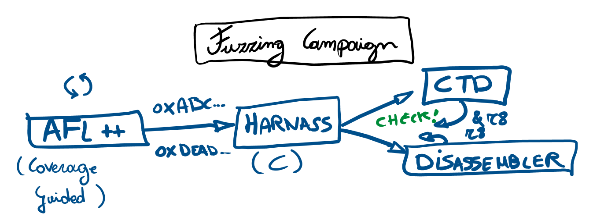

# Overview:

## Code:

Data structures:

- **rip**: Register Instruction Pointer. Pointer to the instruction which is to be executed.
- **rax**: Register Accumulator Extended.
- **r8**: General Purpose Register. Contains extra context

## Return value

### rv

- 0: no access
- 1: read
- 2: write

### ans

absolute adress

# Useful links

## xed

- https://github.com/intelxed/xed/blob/main/examples/xed-dec-agen.c
- https://intelxed.github.io/ref-manual/group__AGEN.html
