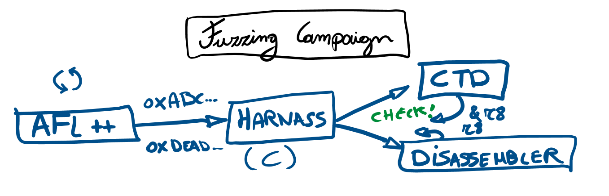
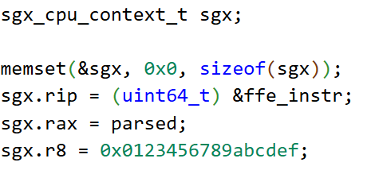
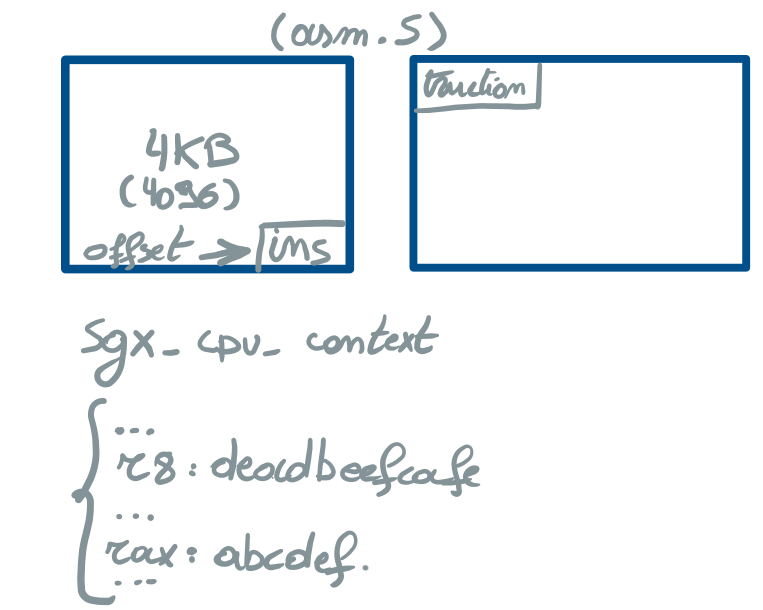

# Readme

Overview:

Code:

Data structures:

**rip**: Register Instruction Pointer. Pointer to the instruction which is to be executed.
**rax**: Register Accumulator Extended. 
**r8**: General Purpose Register.

## Return value

**rv**
0: no access
1: read
2: write

**ans**: absolute adress